<div align="center">

<br />

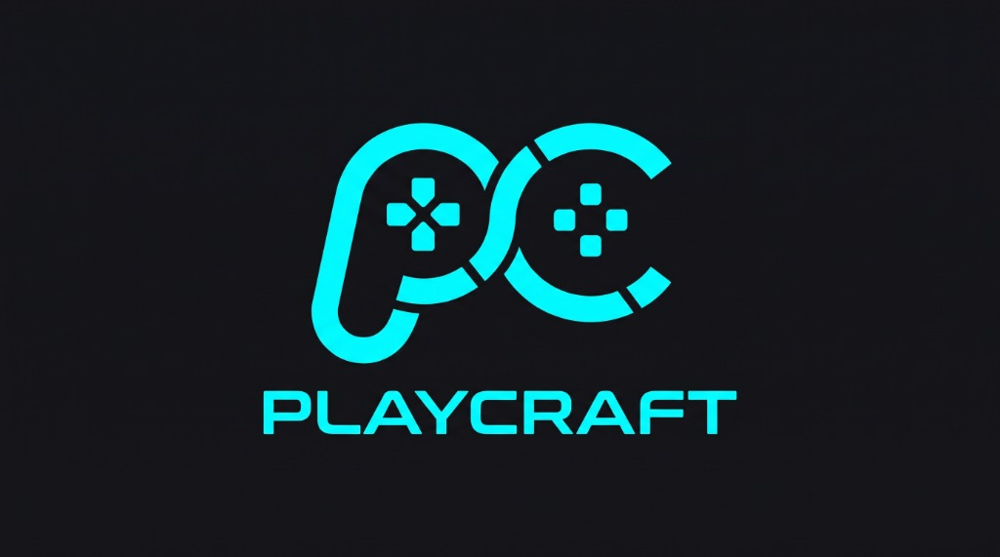

<br />

<h3>PS5-Styled Native Windows Game Launcher &amp; 6DoF Gyro Android Controller Ecosystem</h3>
<p><em>Unify every game on your PC (Steam, Epic, GOG, Ubisoft, standalone, offline, or pirated copies) into one 60+ FPS console hub, driven by your phone as a real XInput / DualSense-style gamepad or Force-Feedback Gyro Racing Wheel.</em></p>

<p>
  <a href="https://github.com/RashminaFdo/playcraft/releases/latest"></a>
  <a href="https://github.com/RashminaFdo/playcraft/releases/latest/download/PlayCraft-Setup-v1.0.0.exe"></a>
  <a href="https://github.com/RashminaFdo/playcraft/releases/latest/download/PlayCraft-Controller.apk"></a>
  <a href="https://github.com/RashminaFdo/playcraft"></a>
  <a href="https://www.rashmina.dev"></a>
</p>

<p>
  <a href="#why-i-built-playcraft">Why PlayCraft?</a> &bull;
  <a href="#screenshots-showcase">Screenshots</a> &bull;
  <a href="#console-boot-experience">Boot Intro</a> &bull;
  <a href="#pc-launcher-features">PC Launcher &amp; Optimizer</a> &bull;
  <a href="#android-controller-features">Mobile Controller App</a> &bull;
  <a href="#getting-started">Download &amp; Setup</a> &bull;
  <a href="#building-from-source">Build</a>
</p>

</div>

---

## Why I Built PlayCraft

PlayCraft was engineered by **[Rashmina Fernando](https://www.rashmina.dev)** to fix two real problems I kept running into every day as a PC gamer:

1. **There Was No Clean Unified Launcher For Every Single Game (Even Pirated / Offline Copies)**
   My games were spread everywhere across Steam, Epic Games, GOG Galaxy, Ubisoft Connect, standalone folders, custom `.bat`/`.lnk` launchers, and pirated or offline copies that had no cover art, no playtime tracker, no save backups, no FPS optimization, and no easy controller support. PlayCraft solves that by putting **every single game you own, regardless of where it came from**, into one fast, 60+ FPS PlayStation-inspired home menu with automatic artwork, full root disk size detection, save snapshots, and pre-launch optimization.

2. **Keyboard Racing Controls Suck &amp; Browser Controllers Block Your Gyroscope**
   Playing racing games like **Forza Horizon** on keyboard keys (`A` / `D` tap-steering) ruins smooth cornering, and browser-based mobile controllers constantly stutter or get **blocked from accessing phone gyroscopes by browser HTTPS security rules**.
   So PlayCraft pairs a **dedicated native Android Controller App** directly with a **Rust + ViGEmBus kernel driver bridge**:
   - Windows detects your phone as a **real Xbox 360 / XInput controller** with analog steering, progressive pedals, and **real in-game vibration (force-feedback rumble)**.
   - Switch **Pad ↔ Gyro Steering Wheel**, **PS5 DualSense (`△ ○ × □`) ↔ Xbox (`Y B A X`) visual shell**, and **X360 XInput ↔ Hardware ScanCode Keys** **live while your game is running**.

---

## Screenshots Showcase

<table>
  <tr>
    <td align="center" width="50%">
      <strong>PlayCraft Windows Console Launcher</strong><br />
      
      <sub>PS5-styled home carousel with live RAM/FPS telemetry, hero artwork &amp; root disk footprint</sub>
    </td>
    <td align="center" width="50%">
      <strong>Forza-Ready 6DoF Gyro Racing Wheel (Android)</strong><br />
      
      <sub>Real-time IMU carbon steering wheel, paddle shifters, Rewind, E-Brake &amp; progressive pedals</sub>
    </td>
  </tr>
</table>

<details>
<summary><strong>Windows PC Launcher Gallery (Click to Browse All 10 Screens)</strong></summary>
<br />

| Home Spotlight &amp; Telemetry | Universal Scanner &amp; Auto Artwork | Deep Optimizer &amp; Launch Flags |
| :---: | :---: | :---: |
|  |  | 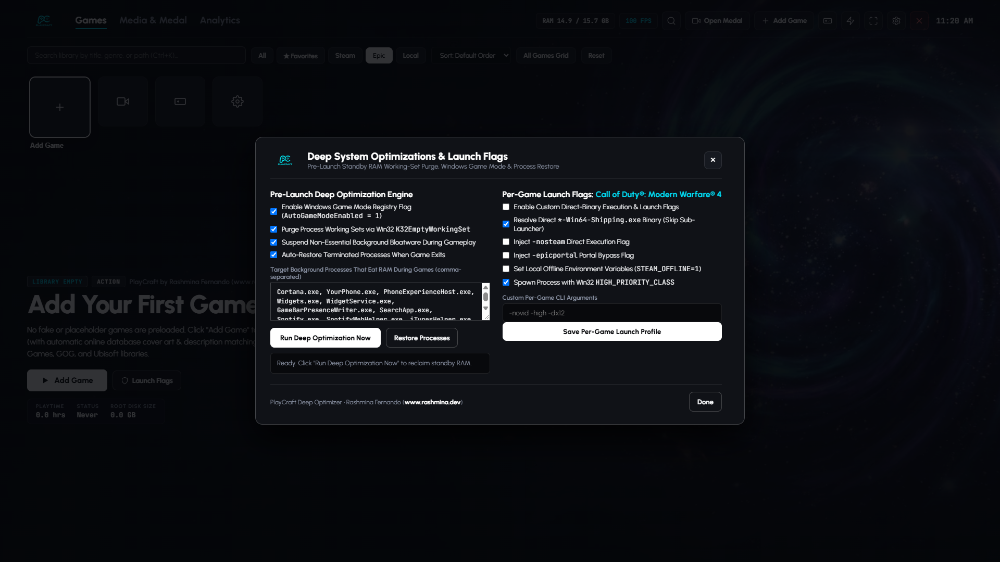 |
| *Main Console Carousel* | *`.exe`/`.bat`/`.lnk` + Online DB Match* | *RAM Purge + Bloat Auto-Restore* |

| Mobile Controller Bridge &amp; QR | Playtime Analytics &amp; Sessions | 4K Wallpapers Selector |
| :---: | :---: | :---: |
|  | 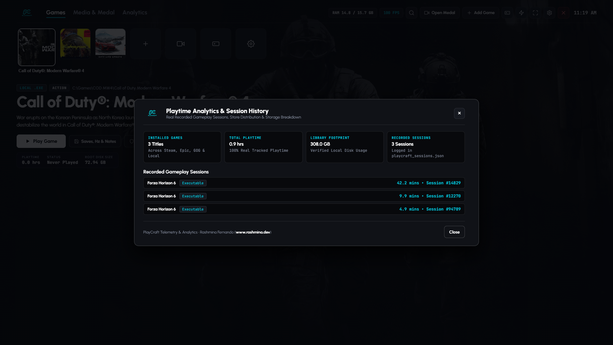 |  |
| *Portrait QR + Multi-IP + BT + USB* | *Real Session Tracking &amp; Footprint* | *5 Bundled 4K Wallpapers* |

| Window Modes, Monitor &amp; Tray | Audio &amp; Console Boot Sequence | Live PC Hardware Specifications |
| :---: | :---: | :---: |
|  |  |  |
| *Primary Monitor + Fullscreen/Borderless* | *WebAudio + Startup Video Controls* | *Real CPU, GPU, RAM &amp; Disk Telemetry* |

| About, Authorship &amp; Auto-Updater | | |
| :---: | :---: | :---: |
|  | | |
| *Daily Update Check + GitHub Release Button* | | |

</details>

<details>
<summary><strong>Android Controller App Gallery (Click to Browse All 8 Screens)</strong></summary>
<br />

| 6DoF Gyro Racing Wheel Deck | DualSense PS5 Pad + Trackpad | Xbox Gamepad Mode (Live Switch) |
| :---: | :---: | :---: |
|  | 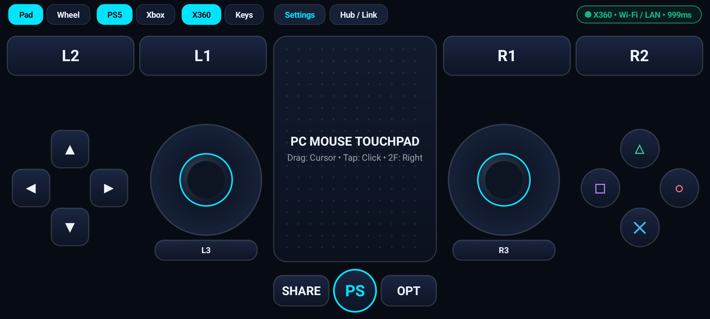 | 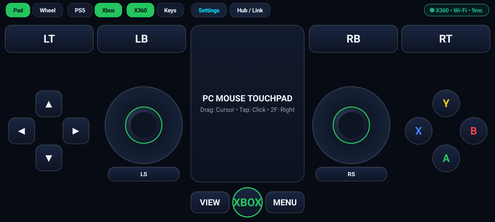 |
| *Carbon Wheel + Pedals + Rewind* | *PS5 Shell + PC Mouse Trackpad* | *Runtime PS5 ↔ Xbox Toggle* |

| Multi-Transport Hub &amp; Remember Me | Upfront Gaming Permissions | Controller Settings &amp; Toggles |
| :---: | :---: | :---: |
| 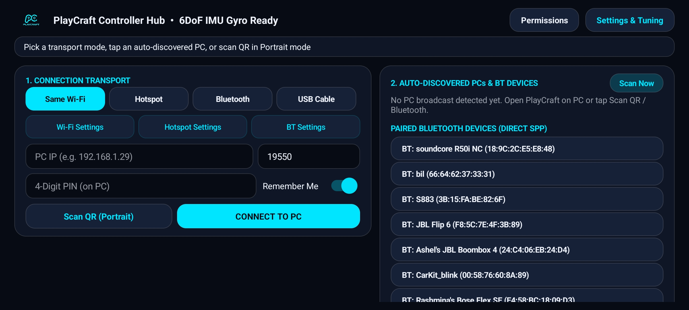 | 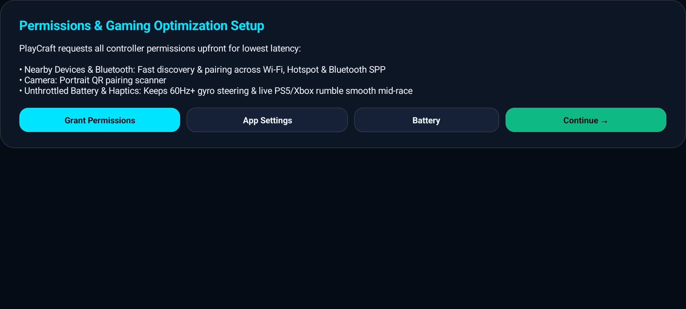 |  |
| *Wi-Fi, Hotspot, Bluetooth SPP &amp; USB* | *Direct App &amp; Battery Redirects* | *Remember Me, Haptics &amp; Pedals* |

| Force-Feedback &amp; Gyro Tuning | OS Shortcuts &amp; Daily Auto-Updater | |
| :---: | :---: | :---: |
|  |  | |
| *Rumble Scale, Angle, Deadzone &amp; Gamma* | *Direct Android Settings + GitHub Updates* | |

</details>

---

## Console Boot Experience

<div align="center">
  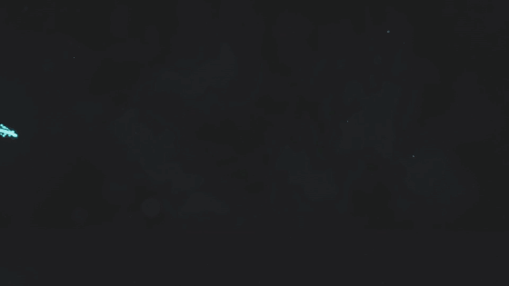
  <br />
  <sub><strong>PlayCraft Neon Particle Boot Sequence:</strong> Plays full-bleed edge-to-edge on both Windows Launcher &amp; Android Controller startup (<a href="ui/assets/boot_intro.mp4">watch original 1080p MP4 with audio</a>). Toggleable or replayable anytime.</sub>
</div>

---

## System Architecture

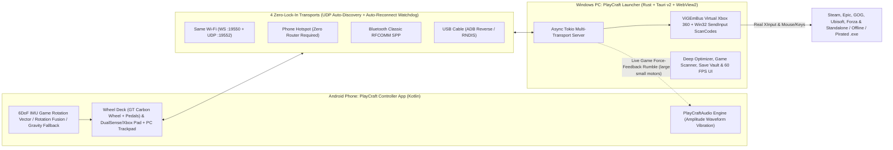

---

## PC Launcher Features

### PS5-Inspired 60+ FPS Glassmorphic Console UI
- **Startup Console Sequence**: 9-second fullscreen `boot_intro.mp4` startup intro (`Esc` to skip, toggle on/off, or replay anytime from Settings).
- **Smooth Focus Carousel & Hero Stage**: GPU-composited tile strip with dual-layer crossfading hero artwork, ambient particle backdrop, synthesized **WebAudio PS5 navigation & launch sound engine**, real-time **RAM telemetry pill**, **FPS counter**, and system clock.
- **5 Built-In 4K Wallpapers + Lock Toggle**: Bundles `Cosmic Singularity Vortex`, `Planetary Cyber Grid`, `Ancient Cyber Monolith`, `Neon Night Cityscape`, and `Mecha Cyber Foundry` (`ui/assets/wallpapers/`) plus local custom wallpaper support and **Always Use Selected Wallpaper** override.
- **Search, Store Filters, Sorting & All Games Grid**: Press `Ctrl+K` to search/filter by `All`, `★ Favorites`, `Steam`, `Epic`, or `Local`, sort by Default Order, Most Played, A-Z, or Disk Size, or open the multi-column **All Games Grid** (`G`).
- **Desktop Context Menu & Safety Confirmations**: Right-click any tile for Play, Favorite, Saves/Hz/Notes, Launch Flags, Open Folder, or Remove. Every destructive or exit action (**Play**, **Exit**, **`Alt+F4`**, **`Ctrl+Q`**, **`Esc`**, **Remove**) asks **"Are You Sure?"** cleanly.

### Universal Game Scanner (Steam, Epic, GOG, Ubisoft &amp; Standalone / Pirated `.exe`)
- **Multi-Store Registry & Manifest Sync**: Automatically imports installed games, playtime, and artwork from **Steam** (`libraryfolders.vdf`, `appmanifest_*.acf`, `localconfig.vdf` + Steam CDN), **Epic Games**, **GOG Galaxy**, and **Ubisoft Connect**.
- **Any `.exe`, `.bat`, or `.lnk` Shortcut**: Pick any offline, portable, DRM-free, or pirated build directly, or recursively bulk-scan an entire `C:\Games` folder. Features a native binary `.lnk` Shell Link parser and silent `CREATE_NO_WINDOW` (`0x08000000`) `.bat` execution (zero flashing command windows).
- **Accurate Root Folder Size & Online Metadata Auto-Match**: Walks upward past `bin/x64` or `Win64` subfolders to calculate true root game folder GB size on disk, and queries online game databases to auto-fill description, genre, cover photo, and hero banner in 1 click (or pick local images).

### Pre-Launch Deep Optimizer &amp; Post-Game Process Auto-Restore
- **Windows Game Mode Registry Toggle**: Enforces `HKCU\Software\Microsoft\GameBar\AutoGameModeEnabled = 1`.
- **Win32 Standby / Working-Set RAM Purge**: Calls Win32 `OpenProcess` + `K32EmptyWorkingSet` across eligible background processes to reclaim memory before launching.
- **33-Target Bloat Suspension & Auto-Restore**: Cleanly suspends memory-heavy background apps during gameplay (`Cortana.exe`, `YourPhone.exe`, `PhoneExperienceHost.exe`, `Widgets.exe`, `WidgetService.exe`, `GameBarPresenceWriter.exe`, `SearchApp.exe`, `Spotify.exe`, `SpotifyWebHelper.exe`, `iTunesHelper.exe`, `AdobeARM.exe`, `CCXProcess.exe`, `CCLibrary.exe`, `AdobeIPCBroker.exe`, `AdobeNotificationClient.exe`, `CoreSync.exe`, `AdobeUpdateService.exe`, `Teams.exe`, `ms-teams.exe`, `Slack.exe`, `Zoom.exe`, `Dropbox.exe`, `GoogleDriveFS.exe`, `GoogleUpdate.exe`, `BraveUpdate.exe`, `Overwolf.exe`, `Wallpaper32.exe`, `Wallpaper64.exe`, `ArmouryCrate.UserSessionHelper.exe`, `RazerCentralService.exe`, `LGHUB_agent.exe`, `WinStore.App.exe`, `CalculatorApp.exe`) while **strictly protecting** Windows core processes, PlayCraft, WebView2/Edge, and OneDrive, then **automatically relaunches suspended apps when the game closes**.

### Per-Game Workspace, Save-Game Vault &amp; Direct Launch Profiles
- **Save-Game Snapshot Vault**: Auto-detects likely save directories, creates timestamped local snapshots manually or **automatically on every launch**, and provides **1-Click Save Restore** against corruption.
- **Per-Game Resolution &amp; Refresh Rate (Hz) Switcher**: Enumerates real Windows display modes (`EnumDisplaySettingsW`), switches monitor resolution/Hz when launching a specific title, and restores desktop settings after exit.
- **Direct-Binary Execution &amp; Launch Flags (`DrmBypassConfig`)**: Auto-resolve `*-Win64-Shipping.exe` directly to skip sub-launchers, toggle `-nosteam`, `-epicportal`, `-novid`, `STEAM_OFFLINE=1` env injection, custom CLI args, `Default` / `Modded` / `Windowed` launch profiles, and Win32 **`HIGH_PRIORITY_CLASS`** priority elevation.
- **Mod Folder &amp; In-Overlay Notes**: Quick-open mod directories and save build/quest/keybind notes synced live to the In-Game Overlay.

### Display Modes, Multi-Monitor, Stability, Tray, Overlay &amp; Daily Updater
- **Primary Monitor Default &amp; Monitor Picker**: Always opens on your **Primary Monitor** by default, with a live monitor selector in Settings.
- **3 Display Modes (`F11` Cycle)**: Switch seamlessly between **Fullscreen**, **Windowed Fullscreen (Borderless)**, and **Normal Window (Title Bar &amp; Resize)**.
- **Single-Instance Guard &amp; Non-Blocking Async Backend**: A Windows named mutex (`Local\PlayCraft_By_Rashmina_Fernando_SingleInstance`) restores and focuses any existing window instead of allowing dual-process WebView2, port, or ViGEm conflicts. All heavy library scans, folder disk size checks, local media scans, telemetry polling, and QR generation run asynchronously on Tokio worker threads with immediate first-run `playcraft_library.json` persistence.
- **Always Stays Alive + Configurable Close `(X)`**: Keeps running open safely during gameplay so your mobile controller never drops; choose whether Close `(X)` exits cleanly (unregistering ViGEm &amp; restoring apps) or minimizes to the Windows System Tray, plus **Launch on Windows Startup**.
- **Global In-Game Overlay (`Ctrl+Shift+O`, Guide Button, `Back+Start`, or Mobile `PS`/`Xbox` Home)**: Displays live CPU load, RAM usage, active game/PID, connected controller count, your per-game Notes, plus quick buttons (**Purge Standby RAM**, **Open Medal.tv**, **Mobile Controller QR**, **Restore Processes**).
- **Playtime Analytics, Live PC Specs &amp; Media Hub**: Tracks real session durations (`playcraft_sessions.json`), queries full live Windows Registry/Kernel CPU, multi-GPU VRAM/drivers, motherboard/BIOS, RAM/Swap, and SSD disk bars, plus **1-Click Open Medal.tv**, Windows Audio Mixer shortcut, and local captures gallery.
- **Daily Silent Auto-Updater + Offline Bundled ViGEmBus Setup**: Checks GitHub Releases once every 24 hours silently when online, shows an in-app **Update Has Arrived** banner + top-bar pill with a **Get Update on GitHub** button, includes **Check for Updates** in Settings, and ships an Inno Setup installer (`PlayCraft-Setup-v1.0.0.exe`) with **ViGEmBus v1.22.0 bundled offline**, automatic running-instance shutdown during upgrades, and full `%LOCALAPPDATA%\PlayCraft` preservation.

---

## Android Controller Features

> **Native Kotlin App (`dev.rashmina.playcraft.controller`) &bull; Registered with `android:isGame="true"` and `android:appCategory="game"` so phones trigger native Game Mode &amp; performance governors.**

### Switch Layout, Brand Shell &amp; PC Driver **Live Mid-Game**
- Use the top segmented bar anytime **while playing** without restarting your game:
  - **Pad ↔ Wheel**: Flip between dual-stick controller and gyro steering cockpit
  - **PS5 ↔ Xbox**: Switch cosmic cyan DualSense (`△ ○ × □`) and emerald Xbox (`Y B A X`) layouts live
  - **X360 ↔ Keys**: Switch between real **ViGEmBus XInput hardware** and **Win32 ScanCode Keyboard/Mouse** live

### 6DoF Hardware IMU Gyroscope Wheel (*Recommended for Forza Horizon*)
- **Zero Browser Restrictions**: Uses Android `SensorManager` natively (**6DoF IMU `TYPE_GAME_ROTATION_VECTOR`** → **`TYPE_ROTATION_VECTOR`** → **`TYPE_ACCELEROMETER`** gravity fallback) with gimbal-lock-free matrix remapping locked to screen rotation (`90°`/`270°`).
- **Realistic GT Carbon Steering Cockpit (`WheelDeckView`)**: Titanium spokes, hex bolts, real-time LED steering telemetry arc, tactile rumble halo, **`GEAR -` (`LB`/`L1`)**, **`GEAR +` (`RB`/`R1`)**, **`E-BRAKE`**, **`REWIND`**, **`MENU`**, **`GYRO ON/OFF`**, **`ZERO`** re-center button, and calibrated **`TOUCH STEER`** slider (**HYBRID**, **GYRO ONLY**, **TOUCH ONLY**).
- **Progressive Slatted Gas &amp; Brake Pedals**: Tap for 100% throttle/brake or slide vertically to feather analog `LT`/`RT` triggers smoothly, with a **Swap Pedal Sides** toggle.
- **Live Racing Calibration**: Adjust **Max Turn Angle** (`20°–90°`), **Center Deadzone** (`0%–15%`), **Non-Linear Gamma Curve** (`0.70–2.20x`), **Filter Responsiveness**, and **Invert Axis**.

### Real PS5 / Xbox Game Force-Feedback Rumble &amp; Audio
- Captures real Windows XInput motor rumble (`large_motor` + `small_motor`) via `vigem-client` and streams rumble packets back over WebSocket and Bluetooth SPP.
- Drives nuanced Android `VibrationEffect` amplitude waveforms (deep crashes/engine torque + sharp curb/gravel/gunfire textures) with an adjustable **Game Rumble Intensity (`0–100%`)** slider, **Test Rumble** button, and synthesized `AudioTrack` UI feedback.

### Responsive DualSense / Xbox Gamepad + Built-In PC Mouse Trackpad
- Partitioned multi-screen layout (`GamepadDeckView`) prevents thumbstick/button collisions on every phone/tablet aspect ratio.
- Features beveled concave **`LS`** / **`RS`** sticks (`L3`/`R3` click), `LT`/`LB`/`RB`/`RT`, D-pad, colored glyphs, `Share`/`View`, `Options`/`Menu`, **`PS`/`Xbox` Home** (opens PC Overlay), and a dot-matrix **PC Mouse Trackpad** (drag cursor, tap left-click, 2-finger tap right-click).

### 4 Transports, Auto-Reconnect Watchdog &amp; Daily Updater
| Transport Mode | When To Use | How Pairing Works |
|---|---|---|
| **Same Wi-Fi** | Phone &amp; PC on same router | Auto-discovered via UDP broadcast (`:19552`), **Portrait Camera2 QR Scan** (+ Torch), or 4-digit PIN |
| **Phone Hotspot** | No router / playing anywhere | Connect laptop to phone hotspot; app auto-discovers &amp; connects over hotspot IP |
| **Bluetooth Classic SPP** | Zero Wi-Fi / offline direct link | Native Windows Bluetooth RFCOMM Serial Port Profile (PlayCraft Service UUID) |
| **USB Cable (ADB / RNDIS)** | Zero wireless interference &amp; charging | 1-click **Bridge Phone via USB Cable (ADB)** on PC + USB mode in app |

- **Remember Me &amp; `2.5s` Watchdog Reconnect**: Saves working endpoint/BT MAC, auto-connects on launch, auto-recovers on network restore, and resets stuck inputs on disconnects.
- **Upfront Permissions Wizard, Custom Keymap &amp; OS Shortcuts**: Deep-links straight to App Permissions, Wi-Fi, Hotspot, Bluetooth, Battery Optimization, and full per-button **Edit Key Map**, plus **daily silent GitHub update checks** &amp; in-app **Check for Updates**.

---

## Keyboard &amp; Controller Shortcuts

| Shortcut / Input | Action |
|---|---|
| `←` `→` / D-Pad / `LS` | Navigate games carousel or dialog controls |
| `Enter` / `A` / `Cross` | Activate focused button or prompt **"Play Game"** |
| `Esc` / `B` / `Circle` | Close active dialog / back / open Exit confirmation |
| `Ctrl + Shift + O` / Guide / `PS` | Toggle **Global In-Game PlayCraft Overlay** |
| `Ctrl + K` | Focus quick library search &amp; store filter bar |
| `G` / `F` / `S` / `M` | Toggle **All Games Grid** / **Favorite** / **Settings** / **Mobile Pairing** |
| `F11` | Cycle **Fullscreen → Windowed Fullscreen → Normal Window** |
| `Alt + F4` / `Ctrl + Q` | Prompt safe Exit / Minimize-to-Tray confirmation |

---

## Built-In 4K Wallpaper Collection

<details>
<summary><strong>Preview All 5 Bundled 4K Launcher Wallpapers (Click to Expand)</strong></summary>
<br />

| Cosmic Singularity Vortex | Planetary Cyber Grid | Ancient Cyber Monolith |
| :---: | :---: | :---: |
|  |  | 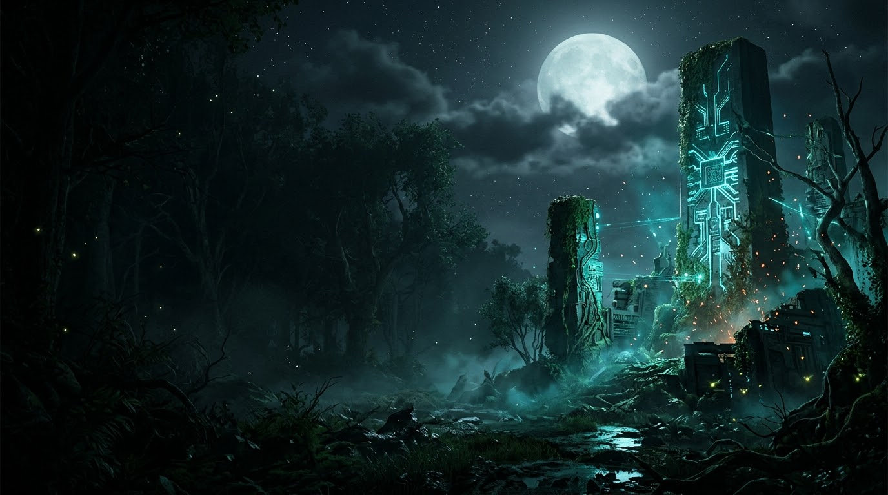 |

| Neon Night Cityscape | Mecha Cyber Foundry | |
| :---: | :---: | :---: |
| 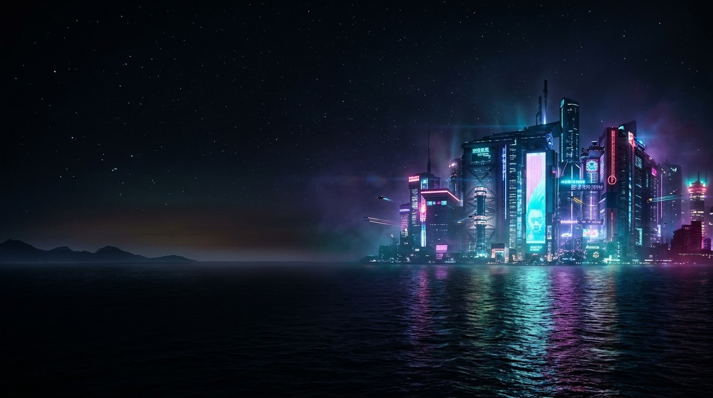 | 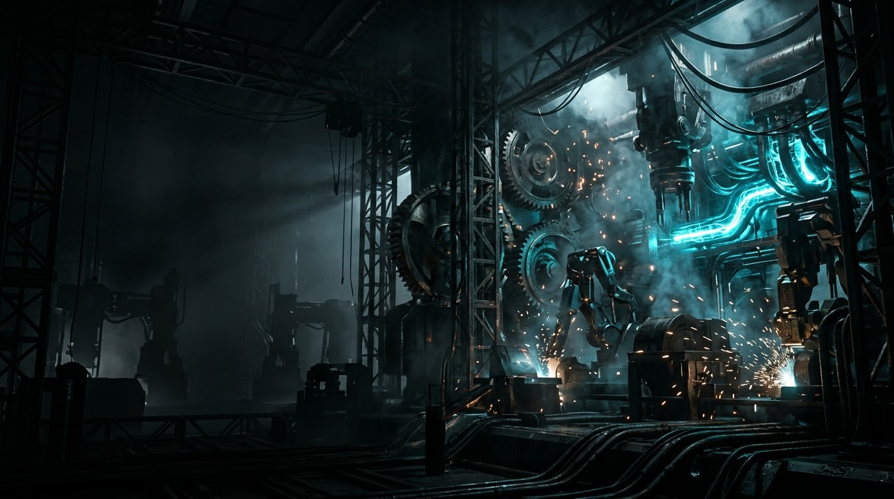 | |

</details>

---

## Getting Started

### Download Latest Release (`v1.0.0`)

Only two files are needed from **[GitHub Releases](https://github.com/RashminaFdo/playcraft/releases/latest)** (the ViGEmBus controller driver is already packed inside the Windows setup):

| Platform | Direct Release Download | Notes |
|---|---|---|
| **Windows 10 / 11 Installer** | **[PlayCraft-Setup-v1.0.0.exe](https://github.com/RashminaFdo/playcraft/releases/latest/download/PlayCraft-Setup-v1.0.0.exe)** | **ViGEmBus v1.22.0 Driver built in offline** (prompts automatically on the finish screen if not yet installed); upgrades auto-close running PlayCraft and preserve `%LOCALAPPDATA%\PlayCraft` |
| **Android Controller (8.0+)** | **[PlayCraft-Controller.apk](https://github.com/RashminaFdo/playcraft/releases/latest/download/PlayCraft-Controller.apk)** | Standalone native Android APK with 6DoF Gyro Wheel, PS5/Xbox shells, Force-Feedback &amp; daily auto-updater |

1. Run **`PlayCraft-Setup-v1.0.0.exe`** on Windows and leave **"Install ViGEmBus Controller Driver"** checked on the final screen if ViGEmBus is not already installed on your PC (no extra download needed).
2. Install **`PlayCraft-Controller.apk`** on your Android phone.
3. Open **PlayCraft** on PC &rarr; click the **Controller icon** (or press **`M`**) &rarr; scan the QR code in the Android app, toggle **Remember Me**, and play.

---

## Building From Source

### Prerequisites
- **Windows 10 / 11** (64-bit) with WebView2 Runtime &amp; MSVC Build Tools
- **Rust toolchain** (`rustup`, stable MSVC `1.77.2+`)
- **Inno Setup 6** (`winget install JRSoftware.InnoSetup`) + `ViGEmBus_1.22.0_x64_x86_arm64.exe` at repo root to compile the Windows installer
- **JDK 21** + **Android SDK** (`compileSdk 36`, `minSdk 26`) for building the mobile APK

### 1. Compile PC Launcher &amp; Windows Installer
```powershell
cargo build --manifest-path src-tauri/Cargo.toml --release
cargo test --manifest-path src-tauri/Cargo.toml

New-Item -ItemType Directory -Force -Path "dist-bundle/PlayCraft-by-Rashmina-Fernando" | Out-Null
Copy-Item -Force "target/release/playcraft.exe" "dist-bundle/PlayCraft-by-Rashmina-Fernando/PlayCraft.exe"
& "$env:LOCALAPPDATA\Programs\Inno Setup 6\ISCC.exe" "installer/PlayCraft.iss"
```

### 2. Compile Android Controller APK
```powershell
cd mobile-app
$env:JAVA_HOME = "C:\Program Files\Java\jdk-21.0.12"
$env:ANDROID_HOME = "$env:LOCALAPPDATA\Android\Sdk"
.\gradlew.bat testDebugUnitTest assembleRelease --no-daemon
```

---

## Project Structure

```text
playcraft/
├── Cargo.toml                              # Workspace manifest + LTO/strip release profile
├── installer/PlayCraft.iss                 # Inno Setup 6 Windows installer (auto-upgrade + bundled ViGEmBus)
├── src-tauri/                              # Rust Tauri v2 backend (Win32, ViGEm, Tokio, Scanner)
│   ├── src/
│   │   ├── lib.rs                          # Single-instance mutex, async Tokio commands, monitors, save vault & updater
│   │   ├── scanner.rs                      # Steam/Epic/GOG/Ubisoft/exe/bat/lnk scanner & online DB lookup
│   │   ├── optimizer.rs                    # Game Mode, K32EmptyWorkingSet RAM purge & process auto-restore
│   │   ├── input_bridge.rs                 # ViGEmBus X360 + live XInput rumble stream + Win32 SendInput
│   │   ├── mobile_server.rs                # Async WebSocket, UDP auto-discovery & Bluetooth SPP server
│   │   ├── models.rs                       # Settings, game library, updater, optimizer & packet schemas
│   │   └── error.rs                        # Typed error definitions
│   ├── capabilities/ & icons/ & gen/
│   └── tauri.conf.json                     # Tauri v2 bundle & embedded UI configuration
├── ui/                                     # 60+ FPS Console WebView2 Frontend (embedded in PlayCraft.exe)
│   ├── index.html & styles.css & app.js
│   └── assets/                             # Cyan logo, boot_intro.mp4 & 5x 4K wallpapers
├── mobile-app/                             # Native Android Kotlin Controller App (Gradle)
│   └── app/src/main/kotlin/dev/rashmina/playcraft/controller/
│       ├── MainActivity.kt                 # Boot video, onboarding, runtime PS5/Xbox/Wheel/Keys UI & settings
│       ├── ControllerDecks.kt              # Realistic GT carbon wheel, pedals, sticks, pads & trackpad Canvas
│       ├── GyroWheelEngine.kt              # 6DoF IMU rotation vector steering, deadzone, gamma & smoothing
│       ├── NetworkBridge.kt                # Wi-Fi/Hotspot WS, UDP discovery, BT SPP, USB & auto-reconnect
│       ├── PlayCraftAudio.kt               # Live PS5/Xbox waveform vibration actuator & UI audio synth
│       ├── AppUpdater.kt                   # Daily silent GitHub Releases updater & manual update check
│       ├── QrScanActivity.kt               # Portrait Camera2 ZXing QR pairing scanner + torch
│       └── ControllerConfig.kt             # Persistent config, Remember Me endpoints & custom keymap
├── Screenshots/                            # Windows & Mobile UI showcase screenshots
└── docs/boot-intro.gif                     # Looping README boot intro preview
```

---

## Author &amp; License

<div align="center">

**Engineered &amp; Designed by Rashmina Fernando**
<br /><br />

<p>
  <a href="https://www.rashmina.dev"></a>
  <a href="https://github.com/RashminaFdo"></a>
  <a href="https://www.linkedin.com/in/rashminafernando/"></a>
  <a href="https://www.instagram.com/rashmina.fernando"></a>
  <a href="https://www.tiktok.com/@rashminafernando"></a>
  <a href="https://www.facebook.com/profile.php?id=61564711284426"></a>
</p>

<sub>Copyright &copy; 2026 Rashmina Fernando (<a href="https://www.rashmina.dev">www.rashmina.dev</a>). Licensed under the PlayCraft Attribution <a href="LICENSE">LICENSE</a>.</sub>

</div>
