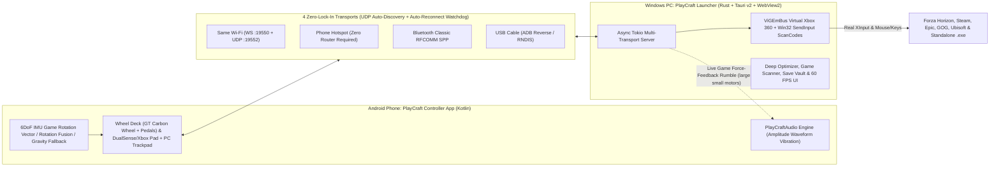

<div align="center">

<br />


<br />

<h3>A Unified PS5-Styled Native Windows Game Launcher &amp; 6DoF Gyro Android Controller Ecosystem</h3>
<p><em>Every game you own (Steam, Epic, GOG, Ubisoft, standalone, portable, or offline) in one console-grade hub, controlled by your phone as a real XInput / DualSense-style gamepad or Force-Feedback Gyro Racing Wheel.</em></p>

<p>
  <a href="https://github.com/RashminaFdo/playcraft/releases"></a>
  <a href="https://github.com/RashminaFdo/playcraft"></a>
  <a href="https://github.com/RashminaFdo/playcraft"></a>
  <a href="https://github.com/RashminaFdo/playcraft"></a>
  <a href="LICENSE"></a>
  <a href="https://www.rashmina.dev"></a>
</p>

<p>
  <a href="#why-i-built-playcraft">Why PlayCraft?</a> &bull;
  <a href="#console-boot-experience">Boot Intro</a> &bull;
  <a href="#pc-launcher-features">PC Launcher Features</a> &bull;
  <a href="#android-controller-features">Mobile Controller App</a> &bull;
  <a href="#system-architecture">Architecture</a> &bull;
  <a href="#getting-started">Download &amp; Setup</a> &bull;
  <a href="#building-from-source">Build from Source</a>
</p>

</div>

---

## Console Boot Experience

<div align="center">
  
  <br />
  <sub><strong>PlayCraft Neon Particle Boot Sequence:</strong> Plays full-bleed on both Windows Launcher &amp; Android Controller startup (<a href="ui/assets/boot_intro.mp4">watch original 1080p MP4 with audio</a>). Toggleable or replayable anytime.</sub>
</div>

---

## Why I Built PlayCraft

PlayCraft was engineered by **[Rashmina Fernando](https://www.rashmina.dev)** to solve two real frustrations every PC gamer hits:

1. **The Fragmented & Standalone Game Problem**
   Your games shouldn't be scattered across five different background-hogging launchers, and standalone, portable, DRM-free, `.bat`-wrapped, or offline `.exe` builds shouldn't be second-class citizens without covers, playtime tracking, save backups, or controller support. PlayCraft puts **every single game you have** into one 60+ FPS PlayStation-inspired living-room dashboard.

2. **The Real Controller & Racing Wheel Problem**
   Playing racing games like **Forza Horizon** on keyboard keys (`A` / `D` tap-steering) ruins cornering precision, and browser-based phone controllers either stutter or get **blocked from reading your phone's gyroscope by HTTPS browser rules**.
   So PlayCraft pairs a **dedicated native Android Controller App** with a **Rust + ViGEmBus kernel bridge**:
   - Windows sees your phone as a **real physical Xbox 360 / XInput controller** with true analog steering, progressive pedals, and **real in-game vibration (force-feedback rumble)** when you hit curbs, gravel, or crashes.
   - Flip between **Wheel Mode** (6DoF IMU Gyro), **Gamepad Mode**, **PS5 DualSense theme** (`△ ○ × □`), **Xbox theme** (`Y B A X`), and **X360 XInput ↔ Keyboard ScanCodes** **live during gameplay** without restarting anything.

---

## System Architecture



---

## PC Launcher Features

### PS5-Inspired 60+ FPS Glassmorphic Console UI
- **Console Boot Intro**: Fullscreen `boot_intro.mp4` sequence on startup (`Esc` to skip, toggleable in Settings, replay on demand).
- **Focus-Driven Tile Strip**: Smooth GPU-composited horizontal carousel with dual-layer crossfading hero banners, floating particle backdrop canvas, procedural **WebAudio PS5 UI Sound Engine**, real-time **FPS** + **RAM telemetry** pills, and live clock.
- **Built-In 4K Wallpapers**: Ships with 5 bundled 4K cyber/obsidian wallpapers (`ui/assets/wallpapers/`) plus support for custom local wallpapers and an **Always Use Selected Wallpaper** lock toggle.
- **Instant Search, Store Chips, Sorting & Grid View**: Filter by `All`, `★ Favorites`, `Steam`, `Epic`, or `Local` (`Ctrl+K`), sort by Default Order, Most Played, A–Z, or Root Disk Size, or open the responsive multi-column **All Games Grid** (`G`).
- **Controller-First & Desktop-Ready**: Full arrow/D-pad/thumbstick spatial navigation, desktop **right-click context menu**, and explicit **"Are You Sure?"** confirmation dialogs for **Launch**, **Exit**, **`Alt+F4`**, **`Ctrl+Q`**, **`Esc`**, and **Remove Game**.

### Multi-Monitor, Display Modes & System Tray
- **Primary Monitor Launch & Monitor Picker**: Automatically opens cleanly on your **Primary Monitor** by default, or target any connected monitor in Settings.
- **3 Display Modes (`F11` Cycle)**: Switch effortlessly between **Fullscreen**, **Windowed Fullscreen (Borderless)**, and **Normal Window (Resizable + Title Bar)**.
- **Always Stays Alive During Gameplay**: Configured to keep running open cleanly in the background/foreground so your **Mobile Controller Bridge** never disconnects mid-game.
- **Configurable Close `(X)` & Startup Behavior**: Choose between **Exit PlayCraft Completely** (cleanly unregisters ViGEm and restores suspended background apps) or **Minimize to Windows System Tray**, plus **Launch on Windows Startup**.
- **Daily Silent Auto-Update Check**: Checks GitHub Releases once every 24 hours silently in the background when online, notifies you inside the launcher with a direct **Get Update on GitHub** button when a new release arrives, and includes a manual **Check for Updates** button in **Settings -> About**.

### Universal Game Scanner: Play *Every* Game You Own
- **Multi-Store Registry & Manifest Auto-Sync**: Auto-imports installed titles, playtime, and metadata from **Steam** (`libraryfolders.vdf`, `appmanifest_*.acf`, `localconfig.vdf`), **Epic Games**, **GOG Galaxy**, and **Ubisoft Connect**.
- **Standalone / Portable / Offline / `.bat` / `.lnk` Games**: Pick any `.exe`, `.bat`, or Windows `.lnk` shortcut (parsed with a native binary Shell Link reader with zero shell popups via `CREATE_NO_WINDOW`) or bulk-scan whole game directories recursively.
- **Accurate Root Folder Size Calculation**: Automatically resolves the real root installation directory size in GB (e.g., excluding fake tiny stub folders) and performs **1-click Online Game Database auto-matching** for official descriptions, genres, cover art, and hero banners (or pick local artwork).

### Per-Game Workspace, Save-Game Vault & Direct Launch Profiles
- **Timestamped Save-Game Snapshot Vault**: Auto-detects likely local save paths, creates **manual or automatic pre-launch save backups**, and restores corrupted saves in **1 click**.
- **Per-Game Resolution & Refresh Rate (Hz) Switcher**: Queries real monitor modes via Win32 `EnumDisplaySettingsW`, switches display resolution/Hz automatically for that title, and restores desktop settings when the game exits.
- **Direct-Binary Execution & Custom Launch Flags (`DrmBypassConfig`)**:
  - Auto-resolve Unreal Engine `*-Win64-Shipping.exe` directly to skip intermediate sub-launchers
  - Toggle `-nosteam`, `-epicportal`, `-novid`, `STEAM_OFFLINE=1` environment injection, custom CLI arguments, `Default` / `Modded` / `Windowed` launch profiles, and Win32 **`HIGH_PRIORITY_CLASS`**
  - Dedicated **Mod Folder** quick-open shortcut and persistent per-game **Notes** synced directly to the In-Game Overlay

### Pre-Launch Deep Optimizer & Background Auto-Restore
- **Windows Game Mode Enforcement**: Enables `HKCU\Software\Microsoft\GameBar\AutoGameModeEnabled = 1`.
- **Win32 Standby RAM Purge**: Trims background process working sets via `OpenProcess` + `K32EmptyWorkingSet`.
- **Smart Bloatware Suspension & Post-Game Auto-Restore**: Safely suspends 33 configurable memory-hungry background processes (`Teams.exe`, `Spotify.exe`, `Slack.exe`, `Adobe*`, `Overwolf.exe`, `ArmouryCrate*`, `LGHUB_agent.exe`, etc.) while strictly whitelisting Windows core, PlayCraft, WebView2, and OneDrive, then **automatically relaunches everything when your game closes**.

### Global In-Game Overlay, Analytics & Media / Medal.tv
- **Global PlayCraft Overlay** (`Ctrl+Shift+O`, Xbox Guide button, `Back + Start`, or Mobile `PS`/`Xbox` Home button): Shows live CPU %, RAM usage, active game & PID, controller bridge status, your saved **Per-Game Notes**, and quick-action buttons (**Purge Standby RAM**, **Open Medal.tv**, **Mobile Controller QR**, **Restore Processes**).
- **Playtime Analytics & Session History**: Tracks real elapsed gameplay sessions into `playcraft_sessions.json` with library distribution cards.
- **Media & Medal Integration**: **1-Click Open Medal.tv**, Windows Per-App Audio Output Mixer shortcut, and built-in local screenshots & clips gallery viewer.

---

## Android Controller Features

> **Native Kotlin App (`dev.rashmina.playcraft.controller`) &bull; Treated by Android as a Real Game App (`android:isGame="true"`, `android:appCategory="game"`).**

### Switch PS5 ↔ Xbox, Pad ↔ Steering Wheel & X360 ↔ Keys **Live During Gameplay**
- Tap the top segmented bar anytime **while your game is running** to switch:
  - **Deck Mode**: **Pad** (Dual-Stick Gamepad) ↔ **Wheel** (Racing Steering Cockpit)
  - **Console Shell**: **PS5 DualSense** (`△ ○ × □`, Cosmic Cyan) ↔ **Xbox** (`Y B A X`, Neon Emerald)
  - **PC Driver Output**: **X360** (Real ViGEmBus XInput Controller) ↔ **Keys** (Hardware ScanCode Keyboard + Mouse)

### 6DoF Hardware IMU Gyroscope Racing Wheel (*Recommended for Forza Horizon*)
- **Zero HTTPS / Browser Blocks**: Direct native Android `SensorManager` pipeline prioritizing **6DoF IMU (`TYPE_GAME_ROTATION_VECTOR`)** → **Rotation Fusion (`TYPE_ROTATION_VECTOR`)** → **Accelerometer Gravity fallback**, using gimbal-lock-free rotation matrix coordinate remapping locked to your landscape rotation (`90°` / `270°`).
- **Realistic GT / F1 Racing Cockpit (`WheelDeckView`)**:
  - Custom-rendered **Carbon & Leather GT Steering Wheel** with titanium spokes, hex bolts, real-time LED steering telemetry arc, and tactile rumble halo
  - Racing controls at your thumbs: **`GEAR -` (`LB`/`L1`)**, **`GEAR +` (`RB`/`R1`)**, **`E-BRAKE`**, **`REWIND`** (built right in for Forza!), **`MENU`**, **`GYRO ON/OFF`**, **`ZERO`** (1-tap re-center), and **`TUNE`**
  - **Progressive Anodized Aluminum Slatted Pedals** (`BRAKE / REV` & `GAS / ACCEL`: tap for instant press or slide vertically to feather analog `LT` / `RT` throttle & brake, plus **Swap Pedal Sides**)
  - **Live Steering Calibration**: Switch **HYBRID (Gyro + Touch)** / **GYRO ONLY** / **TOUCH ONLY**, and dial in **Max Turn Angle** (`20°–90°`), **Deadzone** (`0%–15%`), **Non-Linear Gamma Curve** (`0.70–2.20`), **Smoothing**, and **Invert Axis**.

### Real PS5 / Xbox Force-Feedback Rumble & Audio
- **Two-Way Game Haptics**: Captures real Windows XInput motor intensity (`large_motor` + `small_motor`) via `vigem-client` and streams rumble packets back to your phone.
- Drives nuanced `VibrationEffect` amplitude waveforms on Android (deep impacts & engine torque from `large_motor`, sharp curb/gravel/gunfire textures from `small_motor`), plus UI haptics, synthesized `AudioTrack` navigation chimes, and an adjustable **Game Rumble Intensity (`0–100%`)** slider.

### Responsive DualSense / Xbox Gamepad + Built-In PC Mouse Trackpad
- Partitioned multi-screen-size canvas layout (`GamepadDeckView`) that prevents overlap across compact phones, tall widescreens, and tablets.
- Beveled concave **`LS`** and **`RS`** analog thumbsticks with stick-click (`L3`/`R3`), full **`LT`/`LB`/`RB`/`RT`**, directional pad, colored PS5/Xbox glyphs, **`Share`/`View`**, **`Options`/`Menu`**, **`PS`/`Xbox` Home** (triggers PC Overlay), and a central **PC Mouse Trackpad** (1-finger drag to move cursor, tap for Left-Click, 2-finger tap for Right-Click).

### Connect Anywhere & Stay Connected Automatically
| Transport Mode | When To Use | How Pairing Works |
|---|---|---|
| **Same Wi-Fi** | Phone & PC on same home/studio router | Auto-discovered in <1s via UDP broadcast (`:19552`), **Portrait QR Scan** (`playcraft://pair`), or PIN |
| **Phone Hotspot** | No router available / gaming on the go | Connect laptop to your phone's hotspot; app discovers & bridges over hotspot IP directly |
| **Bluetooth Classic SPP** | Zero Wi-Fi / offline peer-to-peer | Native Windows Bluetooth RFCOMM Serial Port Profile (PlayCraft Service UUID) |
| **USB Cable (ADB / RNDIS)** | Ultra-low latency wired play & charging | 1-click **Bridge Phone via USB Cable (ADB)** on PC + USB transport mode in app |

- **Remember Me + Infinite Auto-Reconnect**: Saves your last verified PC transport/PIN/BT MAC, reconnects automatically when you open the Android app, and monitors link health with a **2.5s heartbeat watchdog** + exponential-backoff reconnect loop (automatically resetting held buttons/sticks on drops).
- **Daily Silent GitHub Update Check**: Quietly checks GitHub Releases once every 24 hours when online, shows an in-app update banner with a 1-tap **Get Update** button when a newer APK is published, and adds **Check for Updates** inside App Settings.
- **Full Custom Keybind Remapper + Onboarding Permissions**: First-launch runtime permission wizard with direct OS Settings deep-links, plus per-button keyboard remapping in **Keys** mode.

---

## Keyboard & Controller Shortcuts

| Shortcut / Input | Action |
|---|---|
| `←` `→` / D-Pad / `LS` | Navigate games carousel or dialog controls |
| `Enter` / `A` / `Cross` | Activate focused button or prompt **"Play Game"** |
| `Esc` / `B` / `Circle` | Close active dialog / back / open Exit confirmation |
| `Ctrl + Shift + O` / Guide / `PS` | Toggle **Global In-Game PlayCraft Overlay** |
| `Ctrl + K` | Focus quick library search & store filter bar |
| `G` / `F` / `S` / `M` | Toggle **All Games Grid** / **Favorite** / **Settings** / **Mobile Pairing** |
| `F11` | Cycle **Fullscreen → Windowed Fullscreen → Normal Window** |
| `Alt + F4` / `Ctrl + Q` | Prompt safe Exit / Minimize-to-Tray confirmation |

---

## Built-In 4K Wallpaper Collection

<details>
<summary><strong>Preview All 5 Bundled 4K Launcher Wallpapers (Click to Expand)</strong></summary>
<br />

| Cosmic Singularity Vortex | Planetary Cyber Grid | Ancient Cyber Monolith |
| :---: | :---: | :---: |
|  |  |  |

| Neon Night Cityscape | Mecha Cyber Foundry | |
| :---: | :---: | :---: |
|  |  | |

</details>

---

## Getting Started

### Option 1: Download Ready-to-Run Release Builds (Recommended)

Grab the latest installers directly from **[GitHub Releases](https://github.com/RashminaFdo/playcraft/releases)**:

1. **Windows PC (`PlayCraft-Setup-v1.0.0.exe` Installer)**:
   - Run **`PlayCraft-Setup-v1.0.0.exe`** (no admin required; installs PlayCraft cleanly into `%LOCALAPPDATA%\Programs\PlayCraft` and creates Desktop/Start Menu shortcuts).
   - **Seamless Updates**: Running a new release installer automatically closes any active or tray-minimized PlayCraft instance, updates the app in place without losing your settings/saves in `%LOCALAPPDATA%\PlayCraft`, and relaunches it cleanly.
   - **ViGEmBus Driver**: If ViGEmBus is not installed yet, the setup finish screen provides an optional 1-click link to **[ViGEmBus Driver](https://github.com/nefarius/ViGEmBus/releases)** so PC games see your phone as a native Xbox 360 controller with gyro steering and vibration *(Keyboard/Mouse ScanCode mode works out of the box)*.
2. **Android Phone (`PlayCraft-Controller.apk`)**:
   - Download and install **`PlayCraft-Controller.apk`** directly on Android 8.0+ (allow installing from unknown sources if prompted).
   - Open PlayCraft on PC &rarr; click the **Controller Icon** (or press **`M`**) to display your QR Code & 4-digit PIN.
   - Open **PlayCraft Controller** on Android &rarr; grant permissions &rarr; tap **Scan QR Code** or **Scan Now** (or choose **Hotspot** / **Bluetooth** / **USB**), enable **Remember Me**, and hit the track!

---

## Building From Source

### Prerequisites
- **Windows 10 / 11** (64-bit) with WebView2 Runtime & MSVC Build Tools
- **Rust toolchain** (`rustup`, stable MSVC `1.77.2+`)
- **Inno Setup 6** (`winget install JRSoftware.InnoSetup`) to compile the Windows `Setup.exe` wizard
- **JDK 21** + **Android SDK** (`compileSdk 36`, `minSdk 26`) for building the mobile APK

### 1. Compile Optimized PC Launcher & Windows Installer
```powershell
# Compile stripped LTO-optimized Windows release binary
cargo build --manifest-path src-tauri/Cargo.toml --release

# Run Rust test suite
cargo test --manifest-path src-tauri/Cargo.toml

# Build Windows Installer (outputs dist-bundle/PlayCraft-by-Rashmina-Fernando/PlayCraft-Setup-v1.0.0.exe)
Copy-Item -Force "target/release/playcraft.exe" "dist-bundle/PlayCraft-by-Rashmina-Fernando/PlayCraft.exe"
& "$env:LOCALAPPDATA\Programs\Inno Setup 6\ISCC.exe" "installer/PlayCraft.iss"
```

### 2. Compile Android Controller APK (`PlayCraft-Controller.apk`)
```powershell
cd mobile-app
$env:JAVA_HOME = "C:\Program Files\Java\jdk-21.0.12"
$env:ANDROID_HOME = "$env:LOCALAPPDATA\Android\Sdk"
.\gradlew.bat assembleRelease --no-daemon
```
> Compiled APK output is written to `mobile-app/app/build/outputs/apk/release/app-release.apk`.

---

## Project Structure

```text
playcraft/
├── Cargo.toml                              # Workspace manifest + LTO/strip release profile
├── installer/PlayCraft.iss                 # Inno Setup 6 Windows installer script (PC only)
├── src-tauri/                              # Rust Tauri v2 backend (Win32, ViGEm, Tokio, Scanner)
│   ├── src/
│   │   ├── lib.rs                          # Tauri commands, monitors, window modes, save vault, updater, tests
│   │   ├── scanner.rs                      # Steam/Epic/GOG/Ubisoft/exe/bat/lnk scanner & online DB lookup
│   │   ├── optimizer.rs                    # Game Mode, K32EmptyWorkingSet RAM purge & process auto-restore
│   │   ├── input_bridge.rs                 # ViGEmBus X360 + live XInput rumble stream + Win32 SendInput
│   │   ├── mobile_server.rs                # Async WebSocket, UDP auto-discovery & Bluetooth SPP server
│   │   ├── models.rs                       # Settings, game library, updater, optimizer & packet schemas
│   │   └── error.rs                        # Typed error definitions
│   ├── capabilities/ & icons/ & gen/
│   └── tauri.conf.json                     # Tauri v2 bundle & embedded UI configuration
├── ui/                                     # 60+ FPS Console WebView2 Frontend (embedded in PlayCraft.exe)
│   ├── index.html & styles.css & app.js
│   └── assets/                             # Cyan logo, boot_intro.mp4 & 5x 4K wallpapers
├── mobile-app/                             # Native Android Kotlin Controller App (Gradle)
│   └── app/src/main/kotlin/dev/rashmina/playcraft/controller/
│       ├── MainActivity.kt                 # Boot video, onboarding, runtime PS5/Xbox/Wheel/Keys UI & settings
│       ├── ControllerDecks.kt              # Realistic GT carbon wheel, pedals, sticks, pads & trackpad Canvas
│       ├── GyroWheelEngine.kt              # 6DoF IMU rotation vector steering, deadzone, gamma & smoothing
│       ├── NetworkBridge.kt                # Wi-Fi/Hotspot WS, UDP discovery, BT SPP, USB & auto-reconnect
│       ├── PlayCraftAudio.kt               # Live PS5/Xbox waveform vibration actuator & UI audio synth
│       ├── AppUpdater.kt                   # Daily silent GitHub Releases updater & manual update check
│       ├── QrScanActivity.kt               # Portrait Camera2 ZXing QR pairing scanner + torch
│       └── ControllerConfig.kt             # Persistent config, Remember Me endpoints & custom keymap
└── docs/boot-intro.gif                     # Looping README boot intro preview
```

---

## Author & License

<div align="center">

**Engineered &amp; Designed by Rashmina Fernando**
<br /><br />

<p>
  <a href="https://www.rashmina.dev"></a>
  <a href="https://github.com/RashminaFdo"></a>
  <a href="https://www.linkedin.com/in/rashminafernando/"></a>
  <a href="https://www.instagram.com/rashmina.fernando"></a>
  <a href="https://www.tiktok.com/@rashminafernando"></a>
  <a href="https://www.facebook.com/profile.php?id=61564711284426"></a>
</p>

<sub>Copyright &copy; 2026 Rashmina Fernando (<a href="https://www.rashmina.dev">www.rashmina.dev</a>). Licensed under the PlayCraft Attribution <a href="LICENSE">LICENSE</a>.</sub>

</div>
